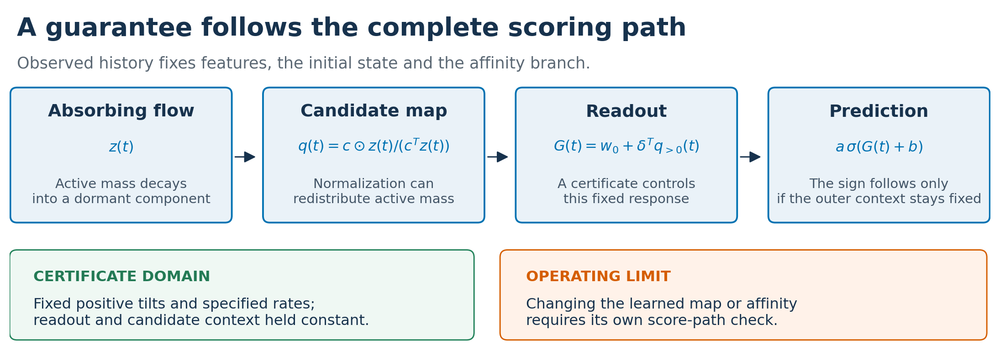
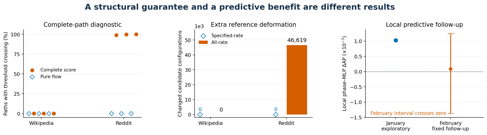

# Lifecycle Readout for Temporal Graphs

### Monotonicity, mechanisms and predictive limits

[Read the article](paper/working/article/main.pdf) · [Explore the full wiki](wiki/INDEX.md) · [Inspect the evidence](wiki/evidence/Repository-Evidence.md) · [Reproduce the figures](figures/README.md)

**When does a decreasing latent state produce a decreasing prediction?**
This project studies temporal graph predictors that combine an absorbing latent
state, candidate-dependent transformations and a learned readout. It develops an
exact certificate for a fixed normalized reweighting at specified decay rates,
extends it to finite rate cones, and expresses the feasible repair as a convex
projection in inverse-tilt coordinates. Retained-model diagnostics and
history-matched controls expose the gap between a structural guarantee and useful
predictions. The strongest current result is a precise certificate and an
auditable account of its operating limits. Predictive superiority and causal
lifecycle semantics are not established.



*The certificate fixes the candidate context, readout, rates and positive tilt
along the elapsed-time path. A general learned transformation or changing
affinity can leave that domain. See the [mathematical assumptions and proof](wiki/methods/Fixed-Rate-Readout-Certificate.md),
[actual tensor pipeline](figures/generated/article/Fig1.png), and [diagram source](figures/source/readme_overview.py).*

## What the project contributes

**An exact restricted certificate.** For an absorbing simplex flow, the normalized
state and its readout are

$$q_i(t)=\frac{c_i z_i(t)}{c^\top z(t)},\qquad
G(t)=w_0+\sum_{i>0}\delta_i q_i(t).$$

At fixed positive tilts and nonnegative readout gaps, the specified-rate
all-initial-state condition reduces to pairwise margins. This separates a
readout guarantee from coordinatewise decline and from the stronger requirement
over every positive rate. The [method page](wiki/methods/Fixed-Rate-Readout-Certificate.md)
owns the exact inequalities, proof and scope; [supporting checks](results/audit/fixed_rate_tilt_v1/verification.json)
are numerical/symbolic evidence, not an independent priority or formal-proof claim.

**A repair with an explicit objective.** In inverse-tilt coordinates, feasibility
is a set of halfspaces. Euclidean projection gives the nearest feasible point in
that coordinate metric. This is a parameter-distance statement, not an AP
optimality theorem. The [geometry and derivation](wiki/methods/Inverse-Tilt-Projection.md),
[implementation](src/lifecycle_readout/modeling/inverse_tilt_projection.py) and
[synthetic optimizer checks](tests/test_inverse_tilt_projection.py) specify what
is actually repaired.

**Controlled evidence about the limits.** Complete retained-model diagnostics,
matched-information prediction controls, cadence and competition studies, and a
next-month follow-up are preserved together. The [claim registry](wiki/claims/Current-Claim-Language.md)
and [limitations](wiki/LIMITATIONS.md) distinguish working observations from
unestablished generalization, semantic and causal claims.

## What the latest evidence shows

The following are scoped working results, not a state-of-the-art leaderboard.
The retained-model paths fix context and use historical-support candidates;
they are not independent observations of real relationship lifetimes.

| Question | Observed result | Evidence and interpretation |
|---|---|---|
| Does pure-flow monotonicity survive the complete score? | Across [66,138 model–candidate trajectories](results/reports/scored-paths.json), pure-flow threshold crossings are [zero](results/reports/scored-paths.json). Complete Reddit paths reverse on [98.9989–100.0000% per checkpoint](results/reports/scored-paths.json); Wikipedia has [zero crossings](results/reports/scored-paths.json). | [Complete path report](results/reports/scored-paths.json) · [definition, threshold and population](wiki/results/Full-Validation-Scored-Paths.md). A grid non-crossing is not exact machine-arithmetic monotonicity. |
| Does the sharper certificate avoid unnecessary repair? | Specified-rate certification requires [zero extra changes across 66,138 reference configurations](results/reports/rate-repair.json); the stronger all-rate repair changes [46,619 Reddit configurations](results/reports/rate-repair.json). | [Matched repair report](results/reports/rate-repair.json) · [scope](wiki/results/Fixed-Rate-Repair-Validation.md). The reference conversion already changes the original dynamic model. |
| Does less deformation improve ranking? | Fixed-rate minus matched all-rate mean ΔAP is [-0.0000012343 on Reddit](results/reports/rate-repair.json) and [zero on Wikipedia](results/reports/rate-repair.json). | [Full paired outcomes](results/reports/rate-repair.json). No mean AP benefit; original dynamic-to-frozen losses remain. |
| Was the exploratory local gain confirmed next month? | January subgroup mean ΔAP is [+0.0010300664](results/reports/january-cohorts.json). February mean is [+0.0000898527](results/reports/february-holdout.json), with a conditional interval [-0.0013744952, +0.0012483761](results/reports/february-holdout.json). | [January strata](wiki/results/LastFM-History-Strata.md) · [February report](wiki/results/LastFM-February-Holdout.md). The prespecified local-confirmation screen is **NOT_ESTABLISHED**. |



*Every plotted value is generated from the [path](results/reports/scored-paths.json),
[repair](results/reports/rate-repair.json), [January cohort](results/reports/january-cohorts.json)
and [February](results/reports/february-holdout.json) records. The February interval
conditions on the selected models, observed users and month; January is an
exploratory selection window. [Plot provenance and numeric inputs](figures/generated/overview/plot-data.json).*

## What an applied ML reader can take away

- Check the **complete score path**, including normalization, transformations and
  affinity, before interpreting a latent-state plot as a prediction guarantee.
- Compare against controls with **the same history information and candidate
  support**. A sampled negative is not an observed relationship termination.
- Keep **geometric repair quality and predictive utility separate**. A closer
  feasible parameter can preserve a response constraint without improving AP.
- Inspect the explicit response branch without treating its latent coordinates
  as verified semantic stages or an explanation of the entire predictor.

The [prediction-target note](wiki/methods/Prediction-Target-and-Sampling.md),
[mechanistic readout audit](wiki/results/LastFM-Mechanistic-Readout.md) and
[broader controlled studies](wiki/results/Hard-Negative-Controls.md) develop these boundaries.

## Explore the complete project

| Start with | What it contains |
|---|---|
| [Full wiki index](wiki/INDEX.md) | Methods, proofs, datasets, literature, decisions, results, claims and evidence |
| [Current project state](wiki/status/Project-Status.md) | Latest outcomes, unresolved questions and next scientific steps |
| [Evidence guide](wiki/evidence/Repository-Evidence.md) and [manifest](evidence/publication-manifest.json) | Distributed reports, original/public hashes and exact publication scope |
| [Source package](src/lifecycle_readout/) | Temporal models, clocks, certificate/projection operators and study implementations |
| [Protocols](protocols/) and [configurations](configs/) | Endpoints, sampling, controls, budgets and input identities |
| [Figures and inputs](wiki/Figures.md) | Explanatory diagrams, vector artwork, numeric data and generators |
| [Article source](paper/README.md) | Current PDF, editable source, aggregate tables and clearly marked historical exports |

## Reproduce the accessible checks

Install the package in a virtual environment using the [declared dependencies](pyproject.toml),
then run the implementation tests and public evidence checks:

```bash
python -m venv .venv
source .venv/bin/activate
python -m pip install -e '.[dev]'
python -m pytest -q
python scripts/verify_public_evidence.py
python figures/source/article_figures.py
python figures/source/readme_overview.py
```

The README itself is regenerated with `python scripts/build_readme.py`; its
reported numbers come from the distributed evidence rather than manual edits.
These checks and figures do not launch remote training.

**Reproducibility boundary.** Source code, the complete wiki, study contracts,
aggregate reports and their provenance are included. Raw third-party corpora,
trained checkpoints, candidate-level arrays and full transport archives are
not redistributed. Full checkpoint/history replay requires those original
inputs; their identities remain in the [retrieval indexes](evidence/indexes/).
The [dataset registry](wiki/datasets/Dataset-Registry.md) records provenance and
provider terms. The evidence and article pointers remain `UNRELEASED`: this is
research source with auditable working results, not an accepted publication or
admission to a frozen scientific release. [License and assets](wiki/governance/License-and-Assets.md).
