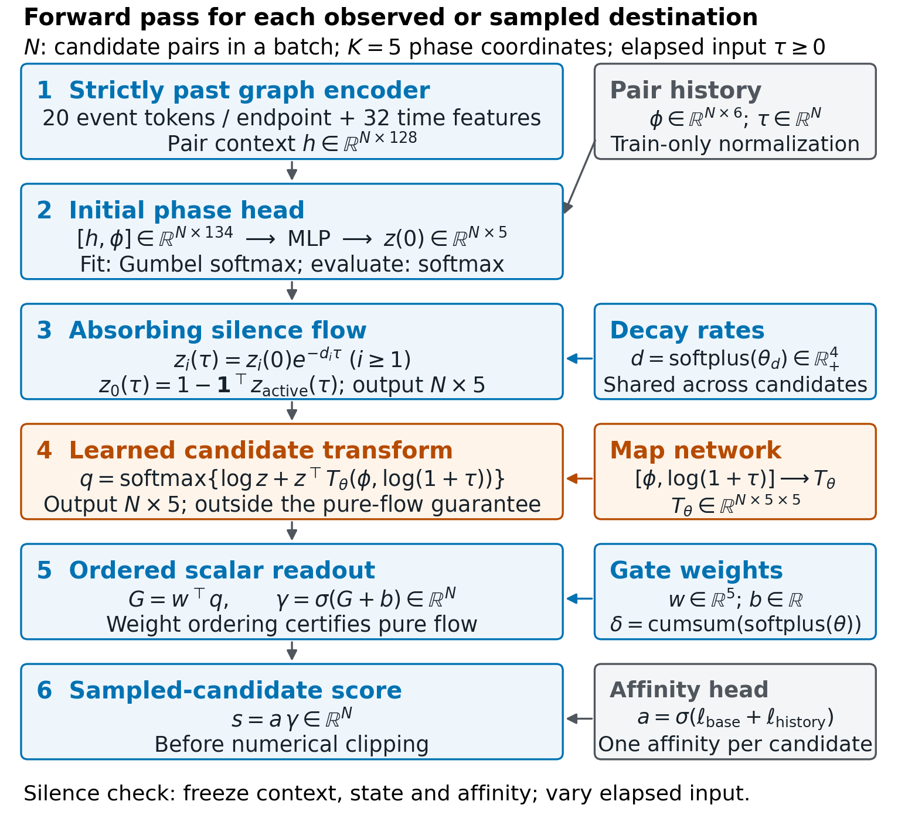
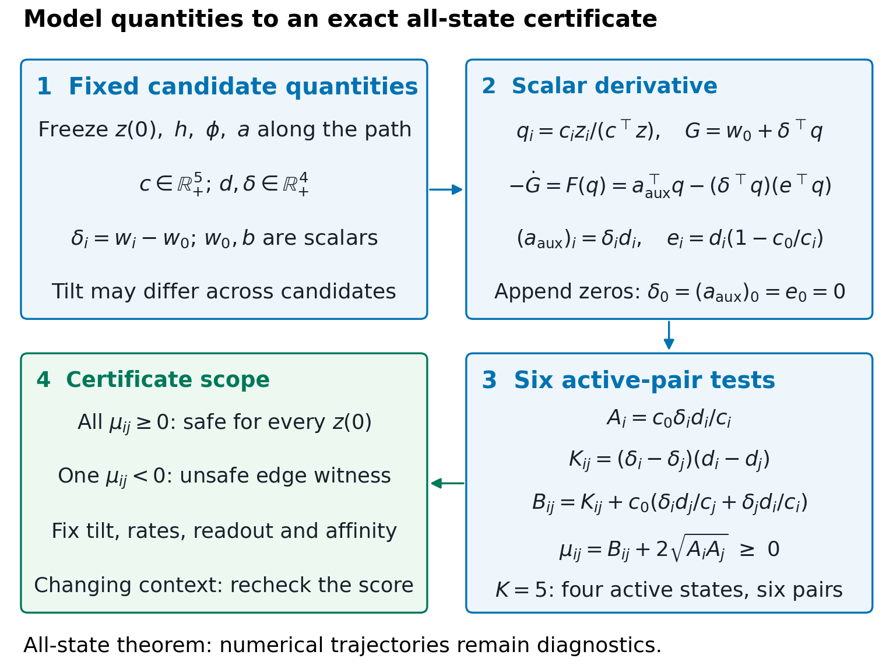
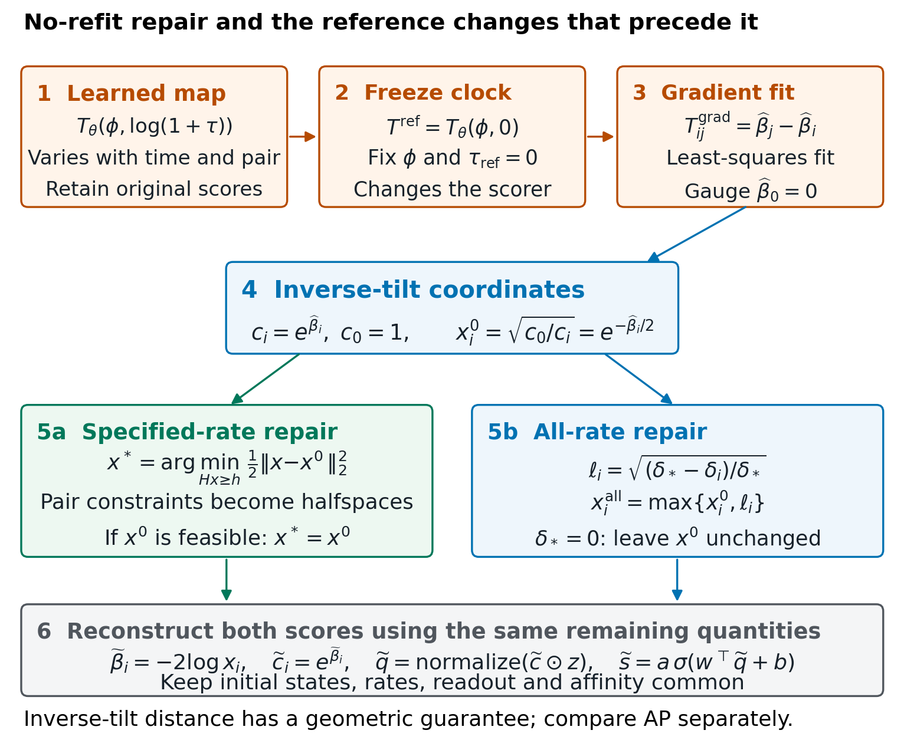

# Article assembly and verification

This page documents the editable article assembled from the canonical wiki,
verified aggregate evidence and reusable figure generators. The publisher class
is a formatting asset, not a commitment to a particular journal. The export is
a working article; both scientific release pointers remain `UNRELEASED`.

## Portable assembly entry point

The [article assembler](../../scripts/build_article.py) reads the canonical
front matter, article body, bibliography and distributed numerical reports.
It writes only to an explicitly supplied mutable output directory:

```bash
python scripts/build_article.py --output /tmp/lifecycle-article
```

This source-generation command does not compile a PDF or change a frozen
snapshot. Compile a regenerated source with a complete TeX/BibTeX toolchain.
The distributed editable package already embeds its reference list and can
be compiled directly as described in its README. Routine research updates
remain in the wiki; assembly is an explicit final-stage operation.

## Canonical article assembly

The reconciled working prose is [the article body](Article-Body.tex), with
[front matter](Article-Front-Matter.tex) and [bibliography](Article-References.bib).
These are assembly components of the wiki narrative. The five table insertion
points are filled directly from the original complete aggregate records; they
are not manually maintained numerical tables. The mutable publisher project is
assembled under `paper/working/article/`, with one self-contained main TeX file,
external figure files and aggregate supplementary CSVs. Historical Word drafts
remain unchanged.

Method/result authority remains with the linked owners in
[Journal Narrative](Article-Narrative.md) and the
[spectral prior comparison](../questions/Spectral-Ratio-Prior-Position.md).
The article leads with the specified-rate characterization, inverse-tilt repair
geometry and the limits of these certificates on complete learned paths.
Mixed predictive controls and the failed February local-confirmation screen
are retained. There is no claim of a superior predictor, causal lifecycle
semantics, identified phase labels, whole-model explanation or cleared priority.


## Author-confirmed declarations

The user supplied these facts directly on 16 October 2026:

- No funding.
- No competing interests.
- Duong Viet Hoang is first author and corresponding author.
- Duong Viet Huy is second author.
- Shih Lun-Min is third author; this display follows the user's latest spelling.
- No ethics approval was supplied/obtained. This is not an institution-issued exemption.

Affiliations and corresponding email follow the retained project manuscript.
Author order does not establish CRediT roles; detailed scientific contribution
assignments have not been invented. The journal recommends a contribution
statement, so authors may add their actual roles during final review.
The article reports secondary public-data analysis and states that no
study-specific approval was obtained. Institutional applicability remains for
authors to verify; no fictitious approval number or exemption is inserted.


## Final review and release boundary

The working export is an author-review package. Final author approval,
institutional ethics applicability, data-use/publication rights and any public
code/model release remain author decisions. The code statement accurately says
that the experimental implementation/models are not publicly available; no
unapproved release or availability promise is made. The user has temporarily removed the standalone tool-assistance disclosure from
the author-review draft and will select an appropriate location for reinsertion.
This does not establish that the actual assistance was limited to copy editing.

External mathematical review and the repository's evidence/snapshot locking are
not replaced by a successful PDF build. No journal upload, payment, contact,
remote fit or compute allocation is part of this preparation. Technical build,
visual and disclosure checks are recorded privately alongside the working
export, outside the reader-facing source package.


## Technical completion

The author-review export contains 28 pages, eight vector Matplotlib figures,
five generated tables, thirty-three references and a structured abstract within
the required word range. All pages were rendered and visually inspected;
table/citation/figure references resolve and there are no overfull boxes or
missing glyphs. All PDF fonts are embedded. The expanded working source compiles with the unchanged publisher class/style. The aggregate records include
all 576 month/seed/cohort/arm rows and 480 paired contrasts. Disclosure scanning
of the reader-facing manuscript and curated source/data files passes. Three
relevant repository/wiki contract checks pass; release pointers remain unchanged.

The [public evidence manifest](../../evidence/publication-manifest.json) maps distributed evidence to its source identities and checksums.


## Zero-valued figure clarification

A reader correctly identified the empty-looking Wikipedia panel in the former Fig. 5 (now Fig. 7).
The original records contain zero changes under both repairs for all three
Wikipedia seeds; these are observed zeros, not missing data. The specified-rate
Reddit values are also zero. Figures 6 and 7 now display distinct baseline
markers and explicit zero annotations, and bar hatches distinguish paths/repairs
in grayscale. The numerical CSV values and conclusions are unchanged. Figure
caption terminal punctuation and the graphics-program declaration were aligned
with the current journal instructions. The official publisher class/style bytes
remain unchanged; correct authoring-template use is distinct from final publisher
production layout or complete submission readiness.


## Author-controlled disclosure placement

The user requested temporary removal of the separate disclosure subsection and
will choose a suitable location to add it back. This is an author-review edit,
not a finding that only copy editing occurred or that the draft qualifies for
the journal's copy-editing exemption. Existing provenance is preserved. No
replacement claim about exclusive language-editing use is added. The full
current guideline page was read, including source/formatting, supplementary
material, declarations, authorship, ethics and post-acceptance requirements.
The guideline's actual-use distinction remains for the author to reconcile
before submission.


## Eighteen-reference theoretical expansion

The user requested eighteen additional references to explain the theory more
thoroughly. The canonical article now cites 33 unique published sources. The
expansion adds an absorbing-chain/survival interpretation, the sampled-class
posterior identity, a normalization/covariance derivation, the special
copositive-matrix structure, explicit rate-quantifier comparisons and a
primal–dual projection error bound. Monotone-network precedents and competing
views of attention-based explanation delimit what is and is not new.

The core certificate, original comparisons, numerical endpoints and release
pointers are unchanged. The new formulae are explanatory consequences, not new
trained results or a cleared mathematical-priority claim.

| Added source | Role in the article | Verified primary identifier |
|---|---|---|
| Norris (1997) | Absorbing generator and probability-preserving flow | [Source](https://doi.org/10.1017/CBO9780511810633) |
| Aalen, Borgan and Gjessing (2008) | Event-time target, survival and hazard interpretation | [Source](https://doi.org/10.1007/978-0-387-68560-1) |
| Gutmann and Hyvärinen (2010) | Sampled logistic target depends on negative distribution | [Source](https://proceedings.mlr.press/v9/gutmann10a.html) |
| Wainwright and Jordan (2008) | Log-partition Jacobian and covariance explanation | [Source](https://doi.org/10.1561/2200000001) |
| Dür (2010) | Copositivity versus semidefiniteness; simplex quadratic | [Source](https://doi.org/10.1007/978-3-642-12598-0_1) |
| Pinelis (2016) | Moment restrictions and small-support extreme points | [Source](https://doi.org/10.1007/s00186-015-0530-0) |
| Bauschke and Borwein (1996) | Convex feasibility versus nearest-point objective | [Source](https://doi.org/10.1137/S0036144593251710) |
| Boyd and Vandenberghe (2004) | Strict convexity, duality, KKT and primal–dual gap | [Source](https://doi.org/10.1017/CBO9780511804441) |
| Hildreth (1957) | Historical quadratic-programming precedent | [Source](https://doi.org/10.1002/nav.3800040113) |
| Dykstra (1983) | Restricted least squares and nearest feasible repair | [Source](https://doi.org/10.1080/01621459.1983.10477029) |
| Sill (1997) | Exact min–max monotone construction | [Source](https://proceedings.neurips.cc/paper_files/paper/1997/hash/83adc9225e4deb67d7ce42d58fe5157c-Abstract.html) |
| Daniels and Velikova (2010) | Partial monotonicity and signed/positive-weight networks | [Source](https://doi.org/10.1109/TNN.2010.2044803) |
| You et al. (2017) | Constrained calibrator/lattice composition | [Source](https://proceedings.neurips.cc/paper_files/paper/2017/hash/464d828b85b0bed98e80ade0a5c43b0f-Abstract.html) |
| Runje and Shankaranarayana (2023) | Activation-dependent expressivity under sign constraints | [Source](https://proceedings.mlr.press/v202/runje23a.html) |
| Rudin (2019) | Intrinsic interpretability versus post hoc explanation | [Source](https://doi.org/10.1038/s42256-019-0048-x) |
| Jain and Wallace (2019) | Internal weights do not automatically establish explanation | [Source](https://doi.org/10.18653/v1/N19-1357) |
| Wiegreffe and Pinter (2019) | Model-aware explanation tests and scope of the attention debate | [Source](https://doi.org/10.18653/v1/D19-1002) |
| Davis and Goadrich (2006) | PR/ROC distinction; ranking objective differs from geometric repair | [Source](https://doi.org/10.1145/1143844.1143874) |

Verification used publisher/proceedings records, author-hosted published PDFs
and institutional abstracts/manuscripts, with access scope recorded privately.
Full-text access was not obtained for every source: Hildreth is limited to a
historical QP citation; Dykstra, Daniels and the books with restricted access
are cited only for statements supported by the available abstract/excerpt or
independently derived algebra. No claim that all eighteen complete works were
read is made. The Daniels institutional entry contains a conflicting given
name; the bibliography follows the publisher-deposited Marina Velikova record.

Exact symbolic checks pass for the covariance identity, normalized derivative,
homogenized quadratic matrix and mixture-hazard derivative. A rational
projection example checks the primal–dual gap bound. All 33 citation keys are
unique, used in the text and resolve in the compiled bibliography. These checks
do not replace external theorem or priority review.


## Figure-to-file map

The following links identify the current eight-figure author-review package.
PNG links open wiki previews; PDF/EPS links open vector artwork. The source
CSV column links the numerical inputs used by the corresponding figure.

| Figure | Content | Preview | Vector files | Numeric input |
|---|---|---|---|---|
| 1 | Tensor-level neural scoring pipeline | [PNG](../../figures/generated/article/Fig1.png) | [PDF](../../paper/working/article/Fig1.pdf), [EPS](../../paper/working/article/Fig1.eps) | Schematic; defined in article |
| 2 | Fixed-candidate certificate workflow | [PNG](../../figures/generated/article/Fig2.png) | [PDF](../../paper/working/article/Fig2.pdf), [EPS](../../paper/working/article/Fig2.eps) | Schematic; defined in article |
| 3 | Safe/unsafe trajectories and redistribution | [PNG](../../figures/generated/article/Fig3.png) | [PDF](../../paper/working/article/Fig3.pdf), [EPS](../../paper/working/article/Fig3.eps) | [CSV](../../paper/working/article/Figure3_data.csv) |
| 4 | Halfspace and projection geometry | [PNG](../../figures/generated/article/Fig4.png) | [PDF](../../paper/working/article/Fig4.pdf), [EPS](../../paper/working/article/Fig4.eps) | [CSV](../../paper/working/article/Figure4_data.csv) |
| 5 | Reference conversion and no-refit repair | [PNG](../../figures/generated/article/Fig5.png) | [PDF](../../paper/working/article/Fig5.pdf), [EPS](../../paper/working/article/Fig5.eps) | Schematic; defined in article |
| 6 | Complete learned-path diagnostics | [PNG](../../figures/generated/article/Fig6.png) | [PDF](../../paper/working/article/Fig6.pdf), [EPS](../../paper/working/article/Fig6.eps) | [CSV](../../paper/working/article/Figure6_data.csv) |
| 7 | Additional tilt deformation | [PNG](../../figures/generated/article/Fig7.png) | [PDF](../../paper/working/article/Fig7.pdf), [EPS](../../paper/working/article/Fig7.eps) | [CSV](../../paper/working/article/Figure7_data.csv) |
| 8 | January discovery and February follow-up | [PNG](../../figures/generated/article/Fig8.png) | [PDF](../../paper/working/article/Fig8.pdf), [EPS](../../paper/working/article/Fig8.eps) | [CSV](../../paper/working/article/Figure8_data.csv); [interval](../../paper/working/article/Figure8_interval.csv) |

[Rebuild all eight figures](../../figures/source/article_figures.py) uses only
committed aggregate CSVs and exact synthetic definitions. The
[three detailed diagram generator](../../figures/source/article_pipeline_diagrams.py)
owns Figures 1, 2 and 5. The canonical [article body](Article-Body.tex)
owns captions and figure references; its eight graphic filenames match the
numbering above. [Editable package](../../paper/working/Article_Editable_Source.zip)
and [compiled article](../../paper/working/article/main.pdf) are working drafts.
Version control does not admit scientific claims or constitute article submission.


## Detailed diagrams connecting theory and implementation

The user requested more detailed visuals for applied ML readers. Figure 1 now
shows the actual ordered scorer's tensor dimensions and the separate affinity
branch. New Figure 2 maps fixed quantities to the derivative and six active-pair
certificate checks. New Figure 5 separates reference-clock freezing, the
gradient-form fit, inverse-tilt projection and final score reconstruction.
The remaining five figures are renumbered, with their numerical source values
unchanged. Captions distinguish exact algebra, numerical guards and fixed-context
scope. Potential vectors now use beta in this bridge to avoid confusing them
with the scalar gate bias.

Implementation dimensions and dependencies were checked directly against the
ordered control, temporal encoder, lifecycle module and retained repair scorer.
These diagrams explain the existing workflow; they add no training outcome or
whole-model guarantee. The project-scoped diagram generator is retained in
`figures/source/article_pipeline_diagrams.py`; reader-facing artwork is vector
PDF/EPS.







The final diagram revision compiles to 28 pages with eight figures and 33
references. All pages were rendered and inspected, with the new diagrams on
pages 7, 8 and 15. A synthetic CPU forward pass confirms the displayed tensor
shapes and zero diagonal; normalized float64 algebra confirms the gradient-form
to constant-tilt identity. All numerical figure and table CSVs match the previous
version byte-for-byte after renumbering. The clean source archive compiles
independently to 28 pages with identical complete text-word counts; all 42 PDF
fonts are embedded. Three wiki/repository contract checks pass. A copy of the
current editable ZIP is also available at `paper/working/Article_Editable_Source.zip`.
